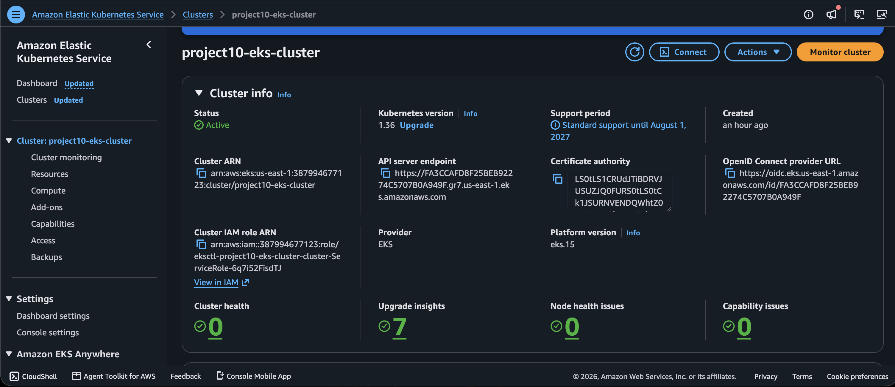
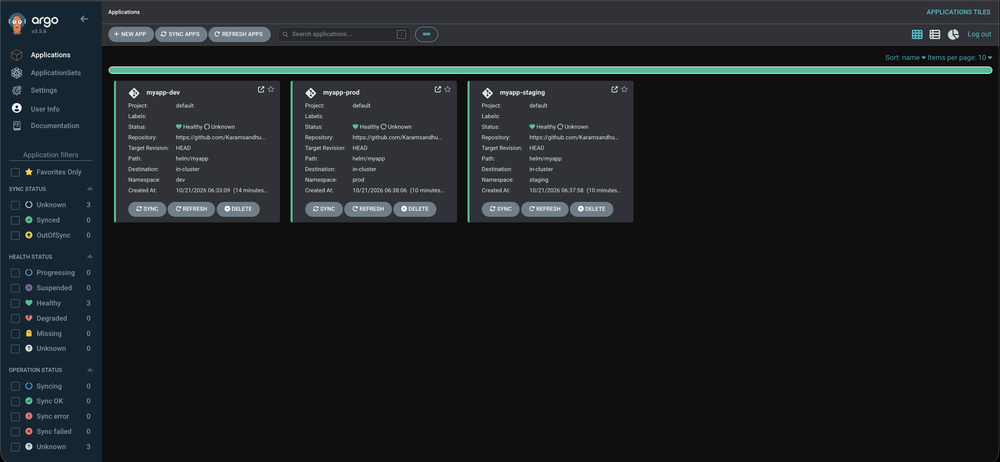

# Project 10: Multi-Environment GitOps Pipeline with AWS EKS, ArgoCD, and Helm

A complete, production-grade GitOps deployment pipeline using **Amazon EKS**, **ArgoCD**, **Helm**, and the **AWS Load Balancer Controller**. This project demonstrates multi-environment infrastructure management (`dev`, `staging`, and `prod`) using Git as the single source of truth.

---

## 🏗️ Architecture Overview

The pipeline leverages an event-driven pull model where **ArgoCD** continuously monitors the GitHub repository and synchronizes application state with the target **Amazon EKS** cluster across segregated Kubernetes namespaces.



### Key Components
* **Amazon EKS (Elastic Kubernetes Service):** Managed Kubernetes cluster in `us-east-1`.
* **ArgoCD:** GitOps continuous delivery tool maintaining cluster state.
* **Helm:** Package manager structuring application templates and per-environment values.
* **AWS Load Balancer Controller (IRSA):** Dynamic provisioning of AWS Application Load Balancers integrated with IAM Roles for Service Accounts.

---

## 📁 Repository Structure

```text
Project-10/
├── cluster.yaml                 # eksctl cluster configuration manifest
├── argocd-app-dev.yaml          # ArgoCD CRD for Development Environment
├── argocd-app-staging.yaml      # ArgoCD CRD for Staging Environment
├── argocd-app-prod.yaml         # ArgoCD CRD for Production Environment
├── helm/
│   └── myapp/                   # Modular Helm chart
│       ├── Chart.yaml
│       ├── values-dev.yaml
│       ├── values-staging.yaml
│       ├── values-prod.yaml
│       └── templates/
└── images/                      # Documentation architecture & dashboard screenshots
    ├── EKS.png
    └── argocd.png
```

---

## 🚀 Getting Started

### Prerequisites
* [AWS CLI v2](https://docs.aws.amazon.com/cli/latest/userguide/getting-started-install.html) configured with active credentials.
* [`eksctl`](https://eksctl.io/) and [`kubectl`](https://kubernetes.io/docs/tasks/tools/).
* [`helm`](https://helm.sh/docs/intro/install/) v3+.

### Step 1: Provision the EKS Cluster
Deploy the EKS cluster using `eksctl`:
```bash
eksctl create cluster -f cluster.yaml
```

### Step 2: Deploy AWS Load Balancer Controller & Namespaces
Create target environment namespaces:
```bash
kubectl create namespace dev
kubectl create namespace staging
kubectl create namespace prod
kubectl create namespace argocd
```

### Step 3: Install & Access ArgoCD
Install ArgoCD core components:
```bash
kubectl apply -n argocd -f https://raw.githubusercontent.com/argoproj/argo-cd/stable/manifests/install.yaml
```

Retrieve the initial admin credentials:
```bash
kubectl -n argocd get secret argocd-initial-admin-secret -o jsonpath="{.data.password}" | base64 --decode
echo ""
```

Port-forward the ArgoCD API Server:
```bash
kubectl port-forward svc/argocd-server -n argocd 8080:443
```
Access the dashboard via `https://localhost:8080`.

---

## 🔄 GitOps Applications Deployment

Deploy all three environment applications to ArgoCD:

```bash
kubectl apply -f argocd-app-dev.yaml
kubectl apply -f argocd-app-staging.yaml
kubectl apply -f argocd-app-prod.yaml
```

### 🖥️ ArgoCD Dashboard View

Once deployed, ArgoCD manages continuous synchronization and automated self-healing across `dev`, `staging`, and `prod`:



---

## 🧹 Cleanup

To tear down all provisioned resources and avoid unnecessary AWS charges:

```bash
eksctl delete cluster -f cluster.yaml
```

